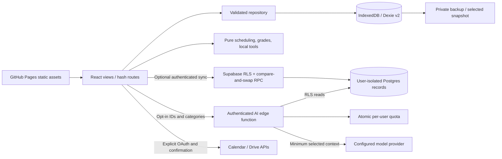

# Architecture

`src/domain` owns schemas and pure algorithms. `src/data` owns transactions and revision checks. `src/integrations` owns optional network clients. `src/ui` owns views and explicit confirmations. The backend is a separately deployed `supabase/functions` edge function and SQL migration. There is no server runtime in GitHub Pages.

Records have a UUID, kind, normalized typed fields, provenance, timestamps, revision, stable sort order and optional tombstone. Courses, projects, focuses and related notes are referenced by ID, not nested duplicate records. Zod validates domain payloads before saves; imports validate every envelope before a transaction. Empty and unknown fields remain absent. The schema deliberately does not store identity, medical diagnoses, bank credentials or model secrets.

Dexie v1 creates records and preferences; v2 adds the sync baseline store. Future migrations must use a new Dexie version and preserve IDs. Export backup v1 includes preferences and all envelopes. Read-only snapshot v1 has category selection, redaction metadata and a stale-data warning; it cannot silently restore a database.

Scheduling builds timezone-aware awake intervals, expands fixed local recurrences, removes busy time and buffers, reserves daily personal time, then places buffered tasks. It does not fill the whole day or invent unrecorded appointments. Hard deadline, school consequence, importance, user priority and dependency availability determine rank. Grade calculations require weighted categories totaling 100% with positive denominators; reported percentages are separate historical snapshots.

Sync compares canonical record content with a stored baseline and a server revision. A remote-only edit pulls; a local-only edit uses a version-checked write. Concurrent edits produce a conflict preview. Local edits arriving during a pull are rejected rather than overwritten. Tombstones remain until a future explicit retention strategy is added. Account databases are isolated by UID; credentials are managed by Supabase Auth. Preferences are currently local to each device.

All record editing is keyboard-accessible. Notes autosave through a serialized queue; a failed save stays visibly unsaved. The graph uses actual explicit links. UI code is split by route; external services are absent until configured. The PWA caches app assets only, with no runtime caching of cloud records or authenticated API responses.

Primary implementation references: [Vite Pages deployment](https://vite.dev/guide/static-deploy.html), [Dexie TypeScript](https://dexie.org/docs/Typescript), [Supabase RLS](https://supabase.com/docs/guides/database/postgres/row-level-security).
